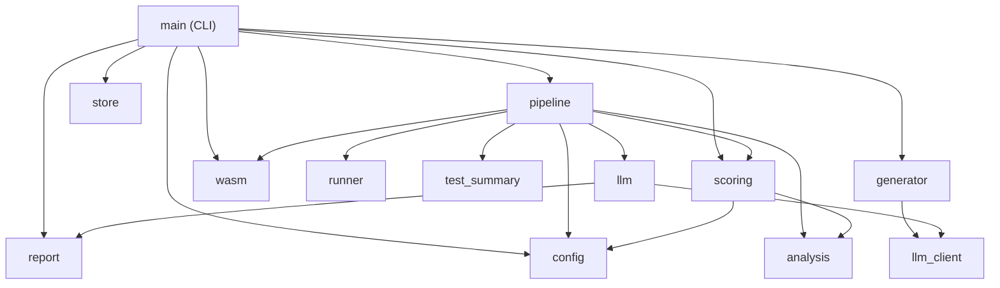

# SafeCode Arena — 設計書

内側の構造をまとめる。外から見た振る舞い（CLI・設定・環境変数）は [spec.md](spec.md)、型の定義は [data-model.md](data-model.md)、決定の経緯は [adr/](adr/) を参照。

## 構成

バイナリ `safecode`（`src/main.rs`）は引数の解釈と入出力だけを持ち、検証・採点はライブラリ `safecode_arena`（`src/lib.rs`）に置く（[ADR-004](adr/ADR-004-cli-library-split.md)）。

矢印は「使う側 → 使われる側」。`model` は全モジュールが共有する型なので図から省いた。`main --> wasm` は引数の検証関数、`llm --> report` はコードフェンスの長さを決める `fence_for`（プロンプトのフェンス脱出対策）の利用である。

## モジュールの責務

| モジュール | 責務 |
| --- | --- |
| `main` | `evaluate` / `generate` / `history` の引数解釈、レポートの出力先、DB への保存と回帰時の終了コード |
| `config` | `safecode.toml` の読み込み。重み（`Rubric`）と言語別の上書き。未知キーと範囲外の値を拒否する |
| `model` | `Candidate` / `Language` / `StageOutcome` / `AxisScores` / `Evaluation` |
| `pipeline` | 候補を一時ディレクトリへ展開し、言語ごとに compile → test → lint →（任意）property test / mutation / bench / Wasm / LLM レビューを実行する |
| `runner` | 1 ステージ分の子プロセス実行。タイムアウト、プロセスグループ単位の kill、環境変数の許可リスト、出力の取り込み上限 |
| `analysis` | ソースの静的解析（`unsafe`・関数長）と、lint ツール出力からの指摘件数の集計 |
| `test_summary` | テスト出力の結果行を読み、終了コードだけに頼らず合否を判定する |
| `wasm` | wasmtime による `wasm32-wasip1` の隔離実行。fuel・メモリ・壁時計の上限 |
| `llm` | LLM セマンティックレビュー（reasoning 軸）。プロンプト生成と応答の解析 |
| `generator` | 自然言語 spec から N 候補を LLM で生成し、応答からコードブロックを取り出す |
| `llm_client` | Claude / Ollama への HTTP 呼び出し（`pub(crate)`）。バックエンドは環境変数で選ぶ |
| `scoring` | 各ステージの結果を重み付きで 5 軸（+ 任意の reasoning）の点数にする。performance は候補間の相対評価 |
| `report` | Markdown / HTML レポートの生成。候補由来の文字列のエスケープ |
| `store` | SQLite への保存と、過去 run との回帰検出 |

## データの流れ（`evaluate`）

1. `config::Config::load` が重みを読む。
2. `pipeline::load_candidates` がファイルを読み、拡張子から `Language` を決めて `Candidate` にする。言語ごとの `Rubric` がここで決まる。
3. `pipeline::evaluate_candidate` が候補ごとに各ステージを実行する。compile / test / lint などは `runner` 経由の子プロセス、Wasm は埋め込みの wasmtime、LLM レビューは HTTP 呼び出しである。結果は `StageOutcome`（Passed / Failed / TimedOut / Skipped）になる。
4. `scoring` が correctness / security / maintainability / resource_usage を候補単体で採点する。
5. 全候補がそろってから `scoring::assign_performance_each` が performance を相対評価で付け、`scoring::assign_reasoning_each` が reasoning を付ける（重みが 0 なら何もしない）。`scoring::rank` が合計点の降順に並べる。
6. `report` が Markdown / HTML を生成する（JSON は `Evaluation` をそのまま出力）。
7. `--db` 指定時は `store` が同じ実行条件の過去 run と比べ、回帰があれば終了コード 1 で終わる。

`generate` は別の短い経路である。`generator::generate` が LLM から Rust の候補を受け取り、既定のオプション（`EvalOptions::default()`）で `evaluate_candidate` を呼ぶ。外部テスト・property test・Wasm・mutation・LLM レビュー・`--db` による回帰検出は通らない。

## 外部依存

| 種類 | 内容 |
| --- | --- |
| 言語ツールチェーン | 評価する言語のコンパイラ・テストランナー・lint（README の「Supported languages」の表）。無いときの扱いはツールで違う: `ruff` / `eslint` / mutation ツールはそのステージが Skipped、`staticcheck` は `go vet` で代用、`cargo-audit` は 0 件扱い、`tsc` は全ステージが Skipped |
| Wasm | `wasmtime`（クレートとして埋め込み）と `wasm32-wasip1` ターゲット（[ADR-007](adr/ADR-007-wasm-sandbox.md)） |
| 永続化 | SQLite（`rusqlite`）。`--db` を指定したときだけ使う |
| LLM | Anthropic Messages API または Ollama。`--llm-review` と `generate` でだけ呼ぶ |

依存クレートの一覧と版は [tech-stack.md](tech-stack.md) と `Cargo.toml` を参照。

## 主要な制約

- **候補のコードはホスト上の子プロセスとして動く。** compile と test はプロセス隔離のみで、Wasm サンドボックスは `--wasm-entry` を指定した Rust 候補の追加ステージである（[ADR-002](adr/ADR-002-sandbox-strategy.md)）。信頼できない候補を評価するときは、ホスト側でコンテナ等の隔離を用意すること。
- **子プロセスに渡す環境変数は許可リスト方式。** `runner` の `ALLOWED_ENV`（`PATH`・`HOME`・ツールチェーン用の変数など）と `LC_*` 以外は渡さない。API キーを環境変数としては渡さないだけで、候補は同じユーザーの権限で動くため、ホスト上のファイルや親プロセスの情報の読み取りまでは防げない（[#234](https://github.com/flipslidersand-labs/safecode-arena/issues/234)、[#300](https://github.com/flipslidersand-labs/safecode-arena/issues/300)）。
- **出力には上限がある。** 取り込みは 4 MiB、出力ファイルは 64 MiB で打ち切る（`src/runner.rs` の `MAX_CAPTURE_BYTES` / `MAX_OUTPUT_FILE_BYTES`）。
- **performance と reasoning は回帰比較に使わない。** performance は同じ run の候補間の相対値、reasoning は LLM の応答で揺れるため、`store::comparable_score` から除いている。
- **回帰比較は実行条件が同じ run どうしだけ。** オプションや重みが違う run とは比べない。
